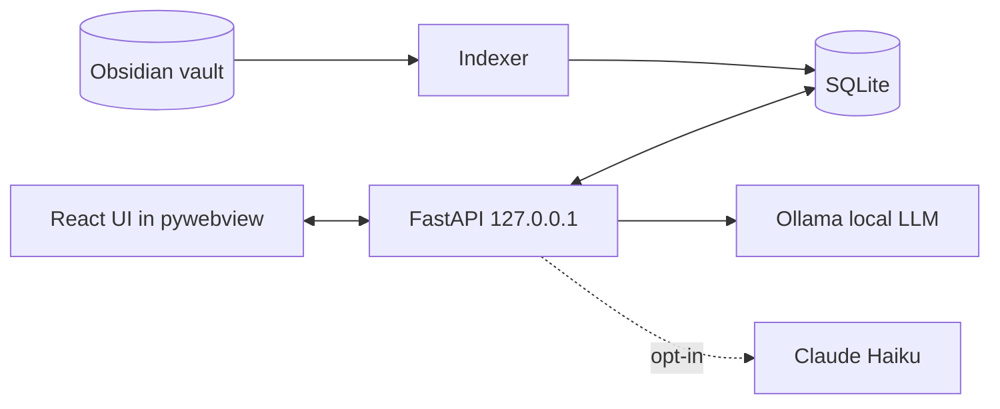

# Executive Assistant

A Windows desktop app that sits on top of an Obsidian vault: every task at a glance, fast note search, and "ask my vault" answers from a local AI model.

> Status: planning. See [docs/plan.md](docs/plan.md).

## Why
Work notes live in a growing Obsidian vault (dated `YYYY-MM-DD` folders, `[ ]`/`[X]` tasks). Tasks get lost across folders, and the right note is hard to find when it's needed.

## Architecture

## How to run
_Coming in M0._

## Data safety
No real notes are ever committed. Development uses the fake vault in `sample_vault/`.
