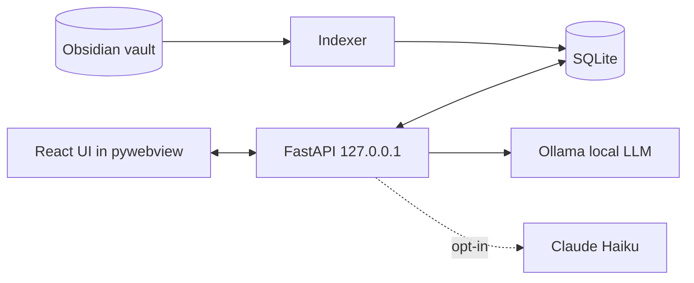

# Executive Assistant

A Windows desktop app that sits on top of an Obsidian vault: every task at a glance, fast note search, and "ask my vault" answers from a local AI model.

> Status: planning. See [docs/plan.md](docs/plan.md).

## Why
Work notes live in a growing Obsidian vault (dated `YYYY-MM-DD` folders, `[ ]`/`[X]` tasks). Tasks get lost across folders, and the right note is hard to find when it's needed.

## Architecture


## How to run (Mac, development)
```bash
conda env create -f environment.yml   # first time only
conda activate executiveAssistant
cd frontend && npm install && npm run build && cd ..
python run_app.py
```
UI hot-reload while coding: run `EA_PORT=8765 python run_app.py` in one terminal and `npm run dev` in `frontend/` in another, then open the Vite URL.

## How the Windows app is built
GitHub Actions (`.github/workflows/build-windows.yml`) builds the React UI, then PyInstaller (`executive_assistant.spec`) on a Windows runner. Run it from the Actions tab, or push a `v*` tag to publish a Release with `ExecutiveAssistant-windows.zip`.

## Project layout
```
src/executive_assistant/   Python backend (FastAPI) + desktop launcher (pywebview)
frontend/                  React + Tailwind UI (Vite, builds to frontend/build)
run_app.py                 entry point (dev + PyInstaller)
executive_assistant.spec   PyInstaller recipe
```

## Data safety
No real notes are ever committed. Development uses the fake vault in `sample_vault/`.
