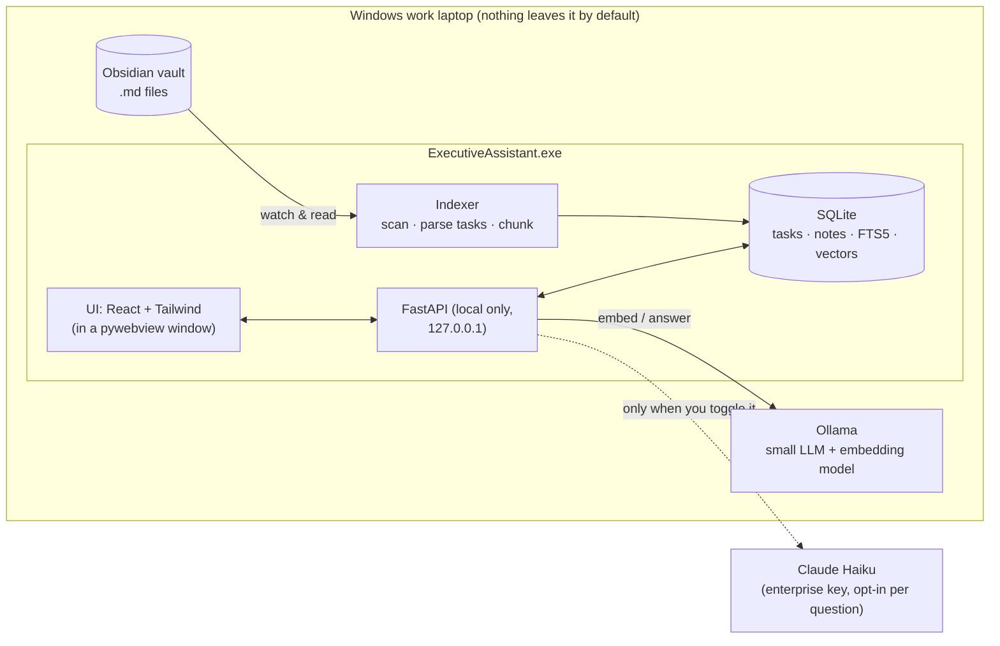
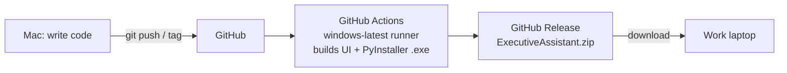

# Executive Assistant — Plan

> Status: **DRAFT, waiting for your approval.** No app code is written until you approve.
> Created: 2026-11-26 · Mode: **builder** (Claude writes the code; RAG/retrieval design explained as we go)

---

## 1. Goal

A **Windows desktop app** for the work laptop that sits on top of your Obsidian vault and:

1. Shows **every task at a single glance** in a clean dashboard, without you hunting through dated folders.
2. Lets you **find the right note** fast: keyword search first, then "ask a question, get an answer with links to the notes".
3. Gives you a **daily briefing**: what's open, what's getting old, and what you wrote yesterday.

**Done for v1.0 (portfolio-ready):** you use it every working day for a week without opening the vault folders by hand to find tasks or notes.

## 2. Facts this plan is built on (from you, 2026-11-26)

| Topic | Answer |
|---|---|
| Purpose | A tool for your day job, not side income and not a learning project |
| Vault | Obsidian, on the **Windows work laptop**, many folders and growing |
| Task format | Folders named `YYYY-MM-DD`. `[ ]` = open / in progress, `[X]` = done |
| AI | **Local first.** Enterprise Claude **Haiku** available as an optional fallback |
| Laptop | 16 GB RAM, no GPU |
| Delivery | Develop on the Mac → push to GitHub → download the `.exe` on the work laptop. Unsigned `.exe` is OK |
| Python | 3.12, conda env `executiveAssistant` |
| secondBrain | Paused while this project runs |

## 3. Scope

**In scope (v1.0)**
- Pick the vault folder once; the app remembers it.
- Read-only scan of all `.md` files → parse tasks and notes into a local SQLite index.
- Task dashboard: open tasks grouped by date folder, oldest first; done vs open counts; filter by folder or text; click to open the note in Obsidian.
- Auto-refresh when files change.
- Keyword search across notes with highlighted snippets.
- "Ask my vault": answers from a local model with citations (links to the source notes), plus a per-question **"Use Haiku"** toggle.
- Daily briefing screen.

**Out of scope (v1.0) → `BACKLOG.md`**
- Writing to the vault (ticking tasks done from the app). The app stays **read-only**, so Obsidian remains the single source of truth and the app can never damage a note.
- Email / calendar integration.
- Mobile, Mac builds, multi-user, sync.
- Code signing / a proper installer (a plain `.exe` folder or zip is enough for v1).

## 4. Architecture

**Key design idea:** tasks need **no AI at all.** `[ ]`/`[X]` plus the folder date is structured data, so parsing it is a deterministic job (regex → table → dashboard). It is instant, free and never wrong in the way an LLM can be. AI is used only where it adds value: answering questions over free text.

**Retrieval plan (FDE-relevant):** a hybrid search. First **keyword search** with SQLite FTS5 (instant on CPU, great for names and IDs). Then **semantic search** with local embeddings (finds "that note about the vendor delay" when you don't remember the words). The best chunks from both go to the LLM, which must cite them.

## 5. Tech choices and trade-offs

### 5.1 Desktop stack — **your decision**

| Option | UI quality | Languages | Build from Mac? | Notes |
|---|---|---|---|---|
| **A. FastAPI + React/Tailwind in pywebview, PyInstaller** (recommended) | ★★★ fully custom, modern | Python + TypeScript | Via GitHub Actions Windows runner | Python half is yours to read and maintain; I write the React half |
| B. Flet (Python, Flutter-rendered) | ★★ Material look, less custom | Python only | Via Windows runner only (`flet build windows` runs on Windows only) | ~189 MB build reported; simplest mental model |
| C. Tauri + Python sidecar | ★★★ | Rust + TS + Python | Experimental NSIS cross-compile; Windows runner is the reliable path | Smallest binary, but three languages is overkill here |

Why A: you asked for a "wonderful UI", and the web stack gives the most control over that. The data and AI logic stays in Python, where you are strongest.

Facts behind the table:
- PyInstaller is not a cross-compiler; Windows `.exe` files must be built on Windows. Building Windows binaries under macOS is unsupported (the FAQ suggests Wine). [PyInstaller usage](https://pyinstaller.org/en/stable/usage.html), [PyInstaller FAQ](https://github.com/pyinstaller/pyinstaller/wiki/FAQ)
- Building per-OS on a GitHub Actions matrix is a known pattern. [sparrow0hawk blog](https://sparrow0hawk.github.io/cross-compile-w-gh-actions/)
- `flet build windows` runs on Windows only and needs Visual Studio 2022; a user measured the output at ~189 MB. [Flet Windows docs](https://docs.flet.dev/publish/windows)
- Tauri v2: MSI needs Windows; NSIS cross-compile from macOS is possible but experimental, with no signing. [Tauri Windows installer](https://v2.tauri.app/distribute/windows-installer/), [Tauri v1 cross-platform](https://v1.tauri.app/v1/guides/building/cross-platform)
- pywebview + PyInstaller: build the React app, then bundle the build folder with `--add-data`. Change Vite's output folder so it doesn't clash with PyInstaller's `dist`. [pywebview freezing guide](https://sources.debian.org/src/python-pywebview/6.1%2Bdfsg-1/docs/guide/freezing.md)
- pywebview uses Microsoft Edge WebView2 on Windows, which ships with Windows 11. **NOT VERIFIED.** M0 tests it on your laptop.

### 5.2 Local AI

| Piece | Choice | Why |
|---|---|---|
| Runtime | **Ollama** (native Windows app, falls back to CPU when there's no GPU) | [Ollama Windows docs](https://docs.ollama.com/windows) |
| Answer model | `qwen3:4b` (~2.5 GB) or `llama3.2:3b` (~2.0 GB); picked by a quality test in M3 | Sizes from a third-party guide. [aiweekly guide](https://aiweekly.co/learning-ai/generative-ai/how-to-run-llms-locally-with-ollama) |
| Embeddings | `nomic-embed-text` via `/api/embed` | Same guide |
| Fallback | Claude Haiku via your enterprise key, **off by default**, toggled per question | Better answers when the local one is weak |

**Be realistic:** CPU-only generation is slow. One source puts a 7B model at about 8 tokens/sec on an i7 and calls it too slow for interactive use. [learnAI ch.5](https://kshirol-dev.github.io/learnAI/SmallModelsLocalAI/05-ollama.html) A 3–4B model will be faster, but expect answers to take several seconds. That is why keyword search (instant) ships first, and why the Haiku toggle exists.

### 5.3 Build / CI cost
- Private repo: Windows minutes count **2×** against the free 2,000 min/month (≈1,000 Windows minutes). Public repos are free. The default spending limit is $0, so you can't be charged by accident. [GitHub Actions billing](https://docs.github.com/en/billing/concepts/product-billing/github-actions)
- Expected build time ~5–10 min per release (**NOT VERIFIED**; measured in M0). That is plenty of headroom.

## 6. Data safety (work data)

- The repo contains **no real notes, ever.** Development uses a **fake sample vault** (`sample_vault/`) that mimics your folder and task format.
- The app only reads the vault and binds its API to `127.0.0.1`, so nothing on the network can reach it.
- Nothing goes to Haiku unless you tick the toggle for that question. The UI shows exactly which note snippets will be sent.
- The enterprise API key lives in a local config file on the laptop, never in Git.

## 7. Milestones

Time budget: 1–2 h weekday evenings, ~3 h/day at weekends. Each task is 30–60 min.

| # | Milestone | Done when | Target |
|---|---|---|---|
| **M0** | **De-risk spike** | A "hello" pywebview `.exe`, built by GitHub Actions, opens on your work laptop. Ollama install allowed and runs one prompt there | **Sun 2026-11-30** |
| **M1** | **Task dashboard** | Pick vault → every `[ ]` task listed by date folder, oldest first, with counts, filters, click-to-open in Obsidian, auto-refresh. Works on the real vault | **Sun 2026-12-13** |
| **M2** | **Keyword search** | Type words → matching notes with highlighted snippets in < 0.5 s; filter by folder/date | **Sun 2026-12-27** (holiday buffer) |
| **M3** | **Ask my vault** | Ask a question → local answer with clickable citations; Haiku toggle works; model picked by a small test set | **Sun 2027-01-17** |
| **M4** | **Daily briefing → v1.0** | Morning screen: open tasks, tasks open > N days, yesterday's notes. One week of daily use | **Sun 2027-01-31** |

M0 comes first because the biggest risks are about your **laptop** (WebView2, IT policy, Ollama), not about code. If something is blocked, we find out in 4 days, not 4 weeks.

### M0 task breakdown
1. Project skeleton, Git, conda env ✅ (env pending the `~/.conda` permission fix)
2. Fake sample vault generator matching your format
3. Minimal FastAPI + pywebview "hello" window running on the Mac
4. GitHub repo + Actions workflow that builds the Windows `.exe` and attaches it to a Release
5. You: download → run on the work laptop; install Ollama → run one prompt. Report back

## 8. Open questions (answer before M1 starts)

1. **Folder structure:** Are tasks only inside `YYYY-MM-DD` folders, or anywhere? Is a date folder one day's notes (several `.md` files), or one note per folder? Are lines written `[ ] task` or `- [ ] task`? *A fake example tree with made-up names is perfect; please don't paste real work content.*
2. **Enterprise Claude access:** a direct Anthropic API key, or a company gateway URL? Does company policy allow sending work note snippets to it?
3. **Ollama:** Are you allowed to install it on the work laptop? (M0 checks this too.)
4. **GitHub repo: public or private?** Private is my recommendation (work tool, free minutes are enough).
5. **Desktop stack:** A, B or C (§5.1)?

## 9. Risks

| Risk | Mitigation |
|---|---|
| IT blocks the `.exe`, WebView2 or Ollama | M0 finds out first. Fallback: run as a local web app in the browser; Haiku-only mode |
| Local model answers are poor or slow | Keyword search ships first; Haiku toggle; model test set in M3 |
| Vault format varies more than expected | Parser driven by a fake sample vault plus your example tree; unknown lines are logged, not crashed on |
| Losing interest mid-way | Each milestone ships something you use daily; M1 alone solves the "can't track tasks" pain |
